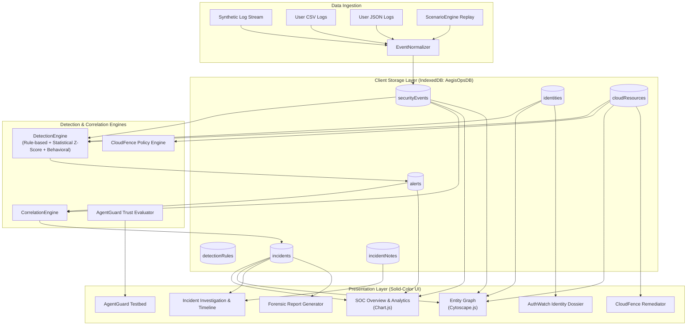

# AEGIS OPS AI — Unified Cyber Defense & Security Intelligence Platform

> **Detect. Investigate. Defend.**  
> An advanced browser-based cybersecurity intelligence, threat detection, and incident response platform.  
> **100% Client-Side • Zero Backend Server Required • GitHub Pages Ready**

[](./tests)
[](./vite.config.js)
[](./LICENSE)
[](https://github.com/GURUPADAYYAODEYAR)

---

## Developer Profile

| Attribute | Details |
|---|---|
| **Author / Lead Engineer** | **GURUPADAYYA ODEYAR** |
| **Role** | Principal Cybersecurity Architect & AI Systems Engineer |
| **GitHub** | [github.com/GURUPADAYYAODEYAR](https://github.com/GURUPADAYYAODEYAR) |
| **LinkedIn** | [linkedin.com/in/gurupadayya-odeyar-461732404](https://www.linkedin.com/in/gurupadayya-odeyar-461732404?utm_source=share&utm_campaign=share_via&utm_content=profile&utm_medium=android_app) |
| **Email** | [gurupadayyaodeyar@gmail.com](mailto:gurupadayyaodeyar@gmail.com) |

---

## 1. Executive Summary & Problem Statement

Modern enterprise Security Operations Centers (SOC) routinely struggle with disconnected, fragmented tooling:
- **Authentication logs** sit in identity providers (Okta, Azure AD).
- **Infrastructure misconfigurations** sit in cloud posture tools (AWS Security Hub, CSPM).
- **Endpoint anomalies** sit in EDR agents (CrowdStrike, Sysmon).
- **Emerging AI risks** (prompt injection, excessive agency) lack integration with primary incident queues.

Analysts are forced to manually correlate disparate data, losing precious time during multi-stage cyberattacks.

### Proposed Solution

**AEGIS OPS AI** solves this by unifying four security modules into a single, cohesive browser-based security intelligence workspace:

1. **SentinelOps:** Security event ingestion, normalization, and alert correlation.
2. **AuthWatch:** Identity threat analytics, behavioral baselining, and impossible travel velocity heuristics.
3. **CloudFence:** Cloud security posture management (CSPM) and interactive remediation simulator.
4. **AgentGuard:** AI agent trust boundary defense, indirect prompt-injection neutralization, and tool permission gating.

---

## 2. Why AEGIS OPS AI is More Than a Dashboard

Unlike static dashboard mockups or visual prototypes:
- **Real Normalization Engine:** Ingests raw JSON and CSV logs, validating timestamps and unifying heterogeneous telemetry into an enterprise schema.
- **Evidence-Backed Detections:** Every alert explicitly links to triggering event IDs and provides an audit-grade technical explanation.
- **Statistical Anomaly Detection:** Implements rolling hourly event volume standard deviation ($Z$-scores) with safeguards against zero-variance false positives.
- **Heuristic Velocity Modeling:** Calculates physical travel speed ($\text{km/h}$) using Haversine great-circle distance formulas.
- **Active Remediation Simulator:** Simulating a cloud posture correction directly modifies local IndexedDB state, automatically triggers policy re-evaluation, decrements active violations, and writes an administrative audit log.
- **Interactive Relationship Graph:** Powered by Cytoscape.js, connecting users, foreign IPs, cloud buckets, and incidents with dynamic neighbor highlighting.
- **Persistent Investigation Records:** Analyst notes, containment transitions, and assignments persist locally in browser IndexedDB.

---

## 3. Architecture & Data Flow



---

## 4. UI/UX Design System — Strict Solid Colors

In strict adherence to enterprise SaaS design requirements, **AEGIS OPS AI uses solid colors exclusively**:
- **NO gradients.**
- **NO neon effects or glowing borders.**
- **NO cyberpunk styling.**
- **NO glassmorphism or excessive blur.**
- **NO animated background particles or decorative blobs.**

### Palette Matrix

| Token | Light Mode | Dark Mode | Usage |
|---|---|---|---|
| **Main Background** | `#F7F8FA` | `#0F1722` | Application backdrop |
| **Primary Surface** | `#FFFFFF` | `#182231` | Cards, tables, drawers |
| **Sidebar** | `#FFFFFF` | `#111B28` | Navigation drawer |
| **Primary Text** | `#17212F` | `#F1F5F9` | Headings and primary copy |
| **Secondary Text** | `#667085` | `#9CAABC` | Subtitles and labels |
| **Border** | `#E4E7EC` | `#2A384A` | Grid and card boundaries |
| **Primary Accent** | `#2563EB` | `#60A5FA` | Active buttons and links |
| **Success** | `#16845B` | `#4BD6A2` | Compliant posture, resolved state |
| **Warning** | `#B7791F` | `#F2C46B` | Medium risk, investigation |
| **Critical** | `#C93C45` | `#F17D85` | Critical alerts, active breach |

---

## 5. Technology Stack

- **Frontend Core:** HTML5, CSS3, ES2022+ JavaScript native modules.
- **Build Tool:** Vite for lightning-fast HMR and production minification.
- **Visualization:**
  - `chart.js` for event activity, threat category distributions, and severity breakdowns.
  - `cytoscape` for interactive entity-incident relationship networks.
  - `lucide` for crisp security iconography.
- **Persistence:** Browser `IndexedDB` (`AegisOpsDB`) with in-memory caching fallback.
- **Testing:** `vitest` for unit and integration testing.
- **Deployment:** GitHub Pages via GitHub Actions.

---

## 6. The 12 Main Functional Pages

1. **Security Overview:** Executive SOC dashboard with live KPIs, event velocity charts, severity doughnuts, and active incident queue.
2. **Security Events (SentinelOps):** Filterable, searchable, paginated log explorer with JSON/CSV import, export, and slide-out inspector drawer.
3. **Threat Detection:** Rules catalog, detection cycle executor, and evidence-backed alert feed.
4. **Incident Investigation:** Multi-stage SOAR incident workspace, chronological evidence timeline, analyst triage notes, and assignment management.
5. **AuthWatch (Identity Security):** Identity roster, risk score calculation breakdown, authentication history, and impossible travel velocity calculator.
6. **CloudFence (Cloud Security):** Cloud asset inventory, policy violation findings, and interactive remediation simulator with live posture recalculation.
7. **AgentGuard (AI Defense):** Trust boundary visualizer, prompt injection defense, tool whitelist enforcer, and automated security test suite.
8. **Entity Graph:** Cytoscape.js relationship network linking users, IPs, resources, and incidents with neighbor highlighting and inspector panel.
9. **Security Analytics:** Deep-dive Chart.js analytics across timelines, severity, categories, and authentication outcomes.
10. **Simulation Lab:** Deterministic scenario laboratory with step-by-step playback, speed control (1x, 2x, 5x, 10x), and live event stream.
11. **Reports:** Audit-ready incident report generator with print-to-PDF layout (`@media print`) and JSON export.
12. **Settings & Data Management:** IndexedDB storage telemetry, system backup/restore, and demo reset.

---

## 7. 10-Step College Demonstration Workflow

Follow this sequence for an academic presentation:

1. **Initialize Security Operations:** Load default enterprise demo environment.
2. **Simulate Authentication Activity:** In **Simulation Lab**, replay *Scenario 1 (Suspicious Login Burst)*.
3. **Run Detection:** In **Threat Detection**, trigger detection cycle and inspect evidence events.
4. **Investigate Identity:** In **AuthWatch**, examine Sarah Chen's impossible travel velocity violation (48,000+ km/h).
5. **Review Cloud Misconfiguration:** In **CloudFence**, audit the public S3 financial vault and wildcard IAM role.
6. **Correlate Security Events:** In **Entity Graph**, observe the cross-module connections between identity and cloud assets.
7. **Incident Investigation:** In **Incidents**, review incident `INC-2026-0881` and add analyst triage notes.
8. **Simulate Remediation:** In **CloudFence**, click *Simulate Remediation* on the S3 bucket and observe posture score hardening.
9. **Test AI Agent Security:** In **AgentGuard**, execute the prompt injection test and observe the deterministic block.
10. **Generate Report:** In **Reports**, review the compiled incident dossier and click *Print to PDF*.

---

## 8. Installation & Local Development

### Prerequisites
- Node.js v18+ (tested on Node.js v20 and v25)
- npm v9+

### Commands
```bash
# Clone the repository
git clone https://github.com/GURUPADAYYAODEYAR/CYBERSEC-AEGISOPS.git
cd CYBERSEC-AEGISOPS

# Install dependencies
npm install

# Run automated tests
npm test

# Start local development server
npm run dev

# Build production bundle for GitHub Pages
npm run build

# Preview production build locally
npm run preview
```

---

## 9. GitHub Pages Deployment

The repository is configured to deploy directly to GitHub Pages via `.github/workflows/deploy.yml`:
1. Push to `main` or `master` branch.
2. The GitHub Actions workflow installs dependencies, runs all 19 automated tests, builds the Vite production bundle, and uploads the artifact to GitHub Pages.
3. In your repository settings: **Settings → Pages → Build and deployment → Source: GitHub Actions**.

---

## 10. Educational Disclaimer

**AEGIS OPS AI** is an offline cybersecurity simulation and security intelligence analysis platform designed for educational, research, and defensive evaluation purposes.
- All telemetry, identities, IPs, cloud configurations, and AI agent scenarios are **safe synthetic simulations**.
- It does **not** connect to real cloud accounts, execute external network scans, or conduct unauthorized penetration testing.
- IndexedDB storage is strictly local to the user's browser; no telemetry is sent to any external server.

---

## 11. License

Released under the **MIT License**. Copyright &copy; 2026 Gurupadayya Odeyar.

