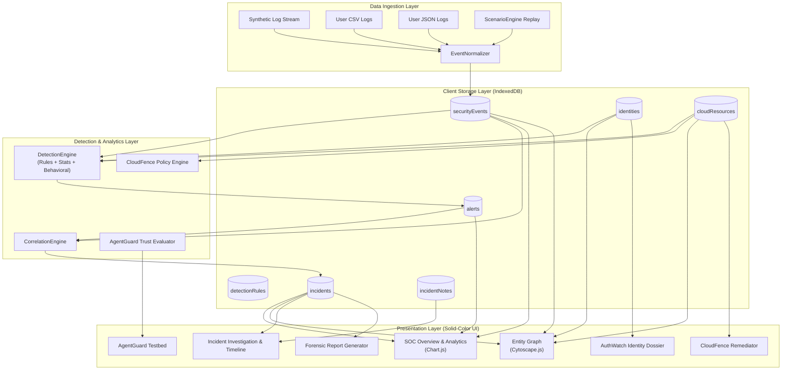

# AEGIS OPS AI — Architecture & Engineering Specification

## 1. System Overview

**AEGIS OPS AI** is an offline, browser-delivered unified cybersecurity intelligence platform engineered with modern standard web standards (HTML5, CSS3, ES2022+ Native Modules, Vite) and runs **100% on GitHub Pages without requiring a backend server**.

## 2. Core Modules

1. **SentinelOps (Security Event Intelligence):**
   - Normalizes raw heterogeneous logs from Okta/IdPs, CloudTrail, CrowdStrike EDR, Firewalls, and AI agent executions into a uniform schema.
   - Provides filtering, searching, sorting, and pagination.

2. **AuthWatch (Identity Threat Analytics):**
   - Tracks synthetic accounts, department privileges, and authentication schedules.
   - Computes great-circle distances and implied physical travel velocities between consecutive logins using Haversine formulas.
   - Calculates transparent, documented risk scores based on observed deviations.

3. **CloudFence (Cloud Security Posture Analysis):**
   - Evaluates synthetic cloud resources (S3, IAM, Security Groups, RDS, CloudTrail).
   - Identifies non-compliant configurations against industry baselines.
   - Features an interactive Remediation Simulator that corrects local configurations, re-runs policy checks, and logs audit events.

4. **AgentGuard (AI Agent Security Evaluation):**
   - Isolates system instructions from untrusted user prompts and retrieved documents.
   - Defends against indirect prompt injection (OWASP LLM01), unauthorized tools (OWASP LLM07), and sensitive credential leakage (OWASP LLM06).

---

## 3. Strict UI Design System

- **Solid Colors Exclusively:** No gradients, neon glows, glassmorphism, or decorative particle canvas.
- **Light & Dark Mode:** Dynamic CSS variable switching with crisp text legibility and high contrast.
- **Top Right Developer Pill:** One-click developer modal spotlighting **Gurupadayya Odeyar** with direct links to GitHub, LinkedIn, and Email.

